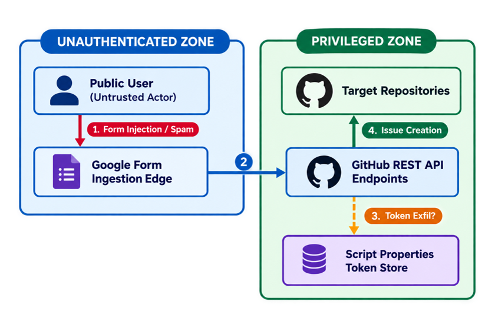
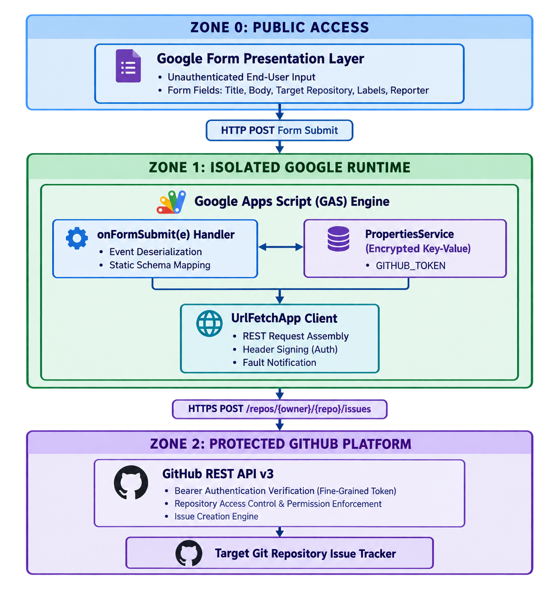

# FeedbackBridge



  
## Objective
I have a few repos which are public, how can I have a google form which is accessible for anyone without logging into GitHub to be able to fill in the details and be able to create an issue in the configured repo. I would have a drop down of repos and the issue logged in should get created in the chosen repo. This will avoid the need to login to GitHub to log the issue. It should be as simple as possible without relying on any paid service or needing a server.

## Implementation
This is a fully free, server-less way to do this: Google Form → Google Apps Script (triggered on submit) → GitHub REST API. Apps Script runs on Google's infrastructure under your Google account, so it can hold your GitHub token privately and make the API call — the person filling out the form never needs a GitHub login or ever sees the token.

## Bridge for Public Google Form → GitHub Issue

Let anyone submit a bug report or feature request through a public Google Form — no GitHub account, no login, and no server — and have it appear automatically as an issue in a GitHub repository of their choice.

Built entirely on free tools:
- **Google Forms** — the public submission form
- **Google Apps Script** — runs the automation, hosted by Google, free
- **GitHub REST API** — creates the issue, authenticated with a scoped personal access token

## Architecture
The architecture is as follows:




## How it works

1. An anonymous visitor fills out the form and picks a repository from a dropdown.
2. Submitting the form fires an Apps Script trigger (`onFormSubmit`).
3. The script reads a GitHub token stored privately in Script Properties.
4. It calls the GitHub REST API to create the issue in the selected repo.

The submitter never sees or needs the GitHub token — the script runs under the form owner's Google account regardless of who submits.

## Prerequisites

- A Google account (to own the Form and the Apps Script project)
- A GitHub account with admin/write access to the target repositories
- About 15–20 minutes

## Setup

### 1. Create the Google Form

Create a blank form at [forms.google.com](https://forms.google.com) with these questions. The question titles must match exactly — the script matches on them.

| Question | Type | Required |
|---|---|---|
| Issue Title | Short answer | Yes |
| Description | Paragraph | Yes |
| Repository | Dropdown — one option per repo you want to expose | Yes |
| Labels | Checkboxes, e.g. `bug`, `enhancement`, `question` | No |
| Your name/email | Short answer | No |

Under **Settings → Responses**, make sure "Restrict to users in [domain]" and "Collect email addresses" are both **off**, so the form is fully public.

Note the **Form ID** from the edit URL — the part between `/d/` and `/edit`:
```
https://docs.google.com/forms/d/FORM_ID/edit
```

### 2. Generate a scoped GitHub token

Go to [github.com/settings/personal-access-tokens/new](https://github.com/settings/personal-access-tokens/new):

1. Name it (e.g. "Google Form issue creator") and set an expiration (fine-grained tokens require one, max 1 year).
2. Set **Resource owner** to the user or org that owns your target repos.
3. Under **Repository access**, choose **Only select repositories** and pick exactly the repos you'll expose in the form's dropdown. Avoid "All repositories."
4. Under **Repository permissions**, set **Issues** to **Read and write**. Nothing else is needed.
5. Click **Generate token** and copy the value immediately (starts with `github_pat_`) — GitHub only shows it once.

> If a target repo belongs to an organization, fine-grained tokens may need to be enabled by an org admin under **Org Settings → Third-party access → Personal access tokens**.

### 3. Create the Apps Script project

Go to [script.google.com](https://script.google.com) → **New project**, and paste the contents of [Code.gs](src/Code.gs) into your generated script file

**NOTE:** Replace `FORM_ID` and the entries in `REPO_MAP` with your own values. 

### 4. Store the GitHub token privately

In the Apps Script editor: **Project Settings (gear icon) → Script Properties → Add script property**.

- Key: `GITHUB_TOKEN`
- Value: the token you copied in step 2

Save. 

The token never appears in the code, so it stays private even if you share the script with others.

### 5. Install the trigger and authorize

1. (Optional but recommended) Select `testFormId` from the function dropdown and click **Run** to confirm the form ID resolves correctly — check **View → Logs** for the form's title.
2. Select `createTrigger` from the function dropdown and click **Run**.
3. Google will prompt for authorization. Click **Advanced → Go to [project name] (unsafe) → Allow**. This warning is normal for a private, unpublished script.
4. Confirm the trigger installed under the clock icon (**Triggers**) in the sidebar: source "From form," event "On form submit."

**NOTE:** Duplicate Triggers Check: If you have run createTrigger() more than once in the past, open the Triggers tab (clock icon on the left navigation bar) and delete any extra duplicate triggers.

### 6. Test it

Open the form's public link in an incognito/private window (to simulate a real anonymous visitor), submit a test entry, and check the target repo's **Issues** tab. The new issue should appear within a few seconds.

## Troubleshooting

| Symptom | Likely cause | Fix |
|---|---|---|
| `Exception: Invalid ID` on `createTrigger` | Wrong `FORM_ID` — often the public `viewform` link was used instead of the edit URL | Re-copy the ID from the form's **edit** URL (`/d/FORM_ID/edit`, no `e/` segment). Verify with `testFormId`. |
| GitHub API error `401` | Token missing, mistyped, or expired | Re-check the `GITHUB_TOKEN` script property; regenerate the token if expired. |
| GitHub API error `403` or `404` | Token doesn't have access to that repo, or repo name in `REPO_MAP` is wrong | Confirm the repo is included in the token's repository access list, and that `owner/repo` is spelled correctly. |
| GitHub API error `422` | Missing required field, or invalid label name | Make sure Title/Description questions are marked required in the form; confirm label names in the form match real labels in the repo. |
| No email, no issue, nothing happens | Trigger not installed, or script not authorized | Check **Triggers** in the sidebar for the `onFormSubmit` entry; re-run `createTrigger` if missing. |

## Maintenance

- **Token rotation**: fine-grained tokens expire (max 1 year). Set a reminder to regenerate the token and update the `GITHUB_TOKEN` script property before it expires.
- **Adding a new repo**: add the new option to the form's Repository dropdown *and* add a matching entry to `REPO_MAP` — the label must match exactly.
- **Adding repo access to the token**: everytime a new repo is added in the script, we would have to update that repo access for the existing token here https://github.com/settings/personal-access-tokens. 

## Security notes

- The token is scoped to only the specific repos you selected, with only Issues read/write access — even if it leaked, the blast radius is limited.
- The form is public, so anyone can submit an issue; worst case is spam issues, not unauthorized access. If abuse becomes a problem, consider adding a simple text-validation question as a lightweight bot filter, or temporarily closing the form.

## Optional enhancements

- **Response logging**: link a Google Sheet to the form (Responses tab → Sheets icon) for an audit trail — no script changes required.
- **Confirmation email**: add a `MailApp.sendEmail(...)` call after a successful issue creation if the form collects the submitter's email.
- **Auto-assign / extra labels**: extend the `payload` object in `createGithubIssue` with `assignees: [...]` or additional `labels`.

<br>
<hr>
Good Luck and Godspeed
<br>
<br>
<sub>© 2026 Santak Das, Tara Design Studio. All rights reserved.</sub>
